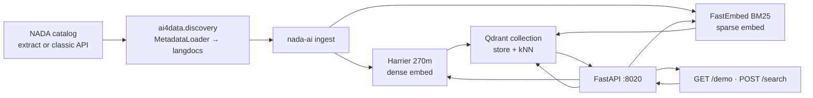
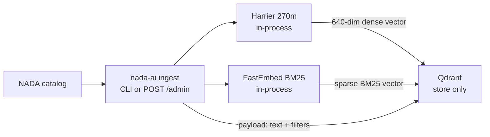
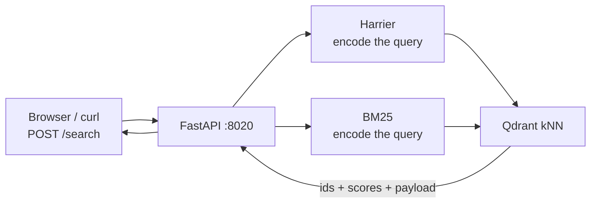

# Architecture: ingest, embeddings, and Qdrant

How catalog ingest, local embedding models, Qdrant, and the search API fit together.

**Qdrant does not run the model.** It only stores vectors and compares them (kNN / sparse / hybrid). Harrier and BM25 run inside **nada-ai** (ingest CLI or the FastAPI process). Hugging Face is only the download source for those weights.

For install, Docker, and catalog ingest commands, see [qdrant-pipeline-guide.md](./qdrant-pipeline-guide.md).

---

## End-to-end

| Piece | Runs a neural model? | Role |
|-------|----------------------|------|
| Local NADA / Data Compass | No | Serves catalog metadata |
| `ai4data.discovery` | No | HTTP client + JSON → searchable text |
| Harrier (`SentenceTransformer`) | **Yes — in nada-ai** | Text → 640-dim dense vector |
| FastEmbed BM25 | **Yes — in nada-ai** (lexical) | Text → sparse token vector |
| Qdrant | **No** | Persist vectors + payload; nearest-neighbor search |
| FastAPI `:8020` | Loads models on warmup | Encode the query, call Qdrant, return hits |

---

## Ingest

1. List records from the catalog (`index_from_catalog` or `index` by idno).
2. `MetadataLoader` fetches JSON and builds **langdocs** (`page_content` + facets).
3. The dense model encodes `page_content` → a 640-dim vector.
4. FastEmbed encodes the same text → a sparse BM25 vector.
5. Qdrant upserts one point per langdoc.

**Catalog URL** is `AI4DATA_METADATA_CATALOG_URL` (ai4data), not `NADA_*`.

- Unset → default [Data Compass](https://data-compass.ihsn.org/).
- Classic mode: `GET …/api/catalog/search` then `GET …/api/catalog/json/{idno}`.
- Extract mode (when `AI4DATA_METADATA_CATALOG_EXTRACT_PATH` is set): paginated `…/search-metadata-extract/studies` (typically needs `AI4DATA_METADATA_CATALOG_X_API_KEY`).

JSON is cached under `AI4DATA_DISCOVERY_DATA_PATH` (default `./data/nada-discovery`).

---

## What Qdrant stores

Each point is numbers + JSON. **Model weights are not stored.**

| Field | Content |
|-------|---------|
| Dense vector (unnamed `""`) | 640 floats, cosine distance |
| Sparse vector `bm25` | FastEmbed BM25 indices/values |
| Payload `page_content` | Searchable text |
| Payload `metadata.*` | `idno`, type, years, countries, … (filters) |

Qdrant has no idea the dense vector came from Harrier. If ingest used model A and search encodes the query with model B, nearest-neighbor is meaningless. Changing `NADA_EMBEDDING_MODEL_ID` requires recreating the collection and re-ingesting.

---

## Search

The query is embedded **again in nada-ai** with the **same** models. Qdrant only compares that query vector to stored vectors.

| `mode` | What Qdrant does |
|--------|------------------|
| `keyword` | Rank with the sparse BM25 vector |
| `vector` | kNN on the dense Harrier vector |
| `hybrid` | Both legs; nada-ai merges with RRF |

Warmup (`POST /health/embeddings/warmup`) loads the dense model into RAM so the first vector/hybrid search is not blocked on model load. It does not download catalog data.

---

## Models and cache

With `NADA_EMBEDDING_BACKEND=local`, nada-ai runs models on the host or in the API container. Hugging Face is where weights are fetched **once**, then cached.

| Role | Default | Library | Used for |
|------|---------|---------|----------|
| Dense (semantic) | `microsoft/harrier-oss-v1-270m` | SentenceTransformers / PyTorch | `vector` and the vector leg of `hybrid` |
| Sparse (lexical) | `Qdrant/bm25` | FastEmbed | Keyword-ish ranking in Qdrant |

There is no in-app model manager. Management is env vars + disk cache + (if the dense model changes) recreate index + re-ingest.

### `NADA_*` knobs

| Variable | Purpose |
|----------|---------|
| `NADA_EMBEDDING_BACKEND` | `local` (this stack) or `opensearch_ml` (OpenSearch only) |
| `NADA_EMBEDDING_MODEL_ID` | Hugging Face id for the dense model |
| `NADA_QUERY_PROMPT_NAME` | Named SentenceTransformer prompt (default `web_search_query`) |
| `NADA_QUERY_PROMPT` | Literal prefix; overrides the name when set |
| `NADA_EMBEDDING_DEVICE` | e.g. `cpu` in Docker, `mps` on Apple Silicon (host) |
| `NADA_EMBEDDING_BATCH_SIZE` | Ingest batch size (default 32) |
| `NADA_EMBEDDING_MAX_SEQ_LENGTH` | Longest input embedded, in tokens (default 1024, a full PDF page); longer texts are cut off for the vector only. Each chunk stores the cap its vector was made with, and a vector is reused only at the same cap, so a change re-embeds each chunk as it is next indexed |
| `NADA_QDRANT_SPARSE_LEXICAL` | On by default; `false` skips BM25 |
| `NADA_QDRANT_SPARSE_MODEL_ID` | Default `Qdrant/bm25` |

### Cache locations

| Env | Typical location |
|-----|------------------|
| `HF_HOME` | Host: `~/.cache/huggingface`. Compose: `/models/huggingface` |
| `SENTENCE_TRANSFORMERS_HOME` | SentenceTransformers hub-style cache |

`docker-compose.qdrant.yml` bind-mounts the host Hugging Face cache into the API container and sets `SENTENCE_TRANSFORMERS_HOME` to `/models/huggingface/hub` so the container reuses the same weights. A separate ST cache forces a second download (often via Hugging Face Xet), which can hang behind corporate TLS.

Optional offline flags in that compose file: `HF_HUB_OFFLINE`, `HF_HUB_DISABLE_XET`, `TRANSFORMERS_OFFLINE`.

Host ingest (`uv run` / `.venv`) and the API container are **separate processes**. Ingesting on the host does not load the model inside Docker; the API still needs warmup (or a first vector search) to load weights in the container.

---

## Alternative: OpenSearch ML

`NADA_EMBEDDING_BACKEND=opensearch_ml` runs embeddings **inside OpenSearch** (`NADA_OPENSEARCH_ML_MODEL_ID` + dimension). That path does not apply when `NADA_SEARCH_BACKEND=qdrant`.

Keyword-only search can run without the dense model. Vector and hybrid cannot: those modes **are** nearest-neighbor on embeddings.
