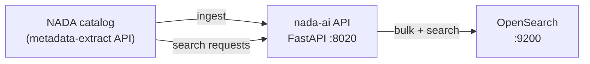

# OpenSearch setup guide

How to install, configure and index **nada-ai** with **OpenSearch**, the default search backend. It covers a local
Docker stack, a self-hosted production cluster, and both embedding options (local
Harrier model or OpenSearch ML Commons).

Running without Docker? Follow the [host setup guide](./opensearch-host-setup.md) to install OpenSearch and the API on
the server, then come back here for [creating the indexes](#5-create-the-indexes) onward.

Qdrant is still supported as an alternative backend: see the [Qdrant pipeline guide](./qdrant-pipeline-guide.md).

**Contents**

1. [What you will run](#1-what-you-will-run)
2. [Prerequisites](#2-prerequisites)
3. [Configure `.env`](#3-configure-env)
4. [Start the local Docker stack](#4-start-the-local-docker-stack)
5. [Create the indexes](#5-create-the-indexes)
6. [Index the catalog](#6-index-the-catalog)
7. [Keep the index in sync with NADA](#7-keep-the-index-in-sync-with-nada)
8. [Connect NADA](#8-connect-nada)
9. [Embedding options](#9-embedding-options)
10. [Production](#10-production)
11. [Operations](#11-operations)
12. [Troubleshooting](#12-troubleshooting)

---

## 1. What you will run



nada-ai keeps **four indexes** in OpenSearch. NADA's catalog search (`/studies/search`, `/variables/search`,
`/citations/search`) runs only on OpenSearch; Qdrant serves `/search` and the MCP tools only. All names derive from
`NADA_INDEX_NAME` (default `nada-metadata`):

| Index | Default name | Holds | Written by |
|---|---|---|---|
| Chunk | `nada-metadata` | Text chunks and their embeddings (`knn_vector`, FAISS HNSW, cosine) | Catalog ingest |
| Study | `nada-metadata-studies` | One document per study (`_id` = NADA's internal study id `sid`); serves `/studies/search` | Catalog ingest |
| Variable | `nada-metadata-variables` | One document per variable; lexical only | Ingest of microdata studies, variable sync |
| Citation | `nada-metadata-citations` | One document per citation; lexical only | Citation sync |

Override any of them with `NADA_STUDIES_INDEX_NAME`, `NADA_VARIABLES_INDEX_NAME` or `NADA_CITATIONS_INDEX_NAME`.

> **Two different "OpenSearch" settings in NADA.** NADA's own `opensearch` search engine is a separate integration
> with its own `nada*` indexes. To use nada-ai, NADA's search engine must be **`nada_ai_opensearch`** (see
> [Connect NADA](#8-connect-nada)).

---

## 2. Prerequisites

- **Python 3.11+** and [**uv**](https://docs.astral.sh/uv/) on the host (for the CLI and host-side runs; the Docker
  image has its own environment).
- **Docker** with Compose v2 (local stack), or an OpenSearch cluster you can reach (production).
- **OpenSearch 3.x** (the compose file and the mapping are tuned for **3.6 LTS**) with the **k-NN** plugin. The
  full OpenSearch distribution includes it.
- A NADA instance and a NADA **admin** API key (the bulk metadata-extract endpoint is admin-only).
- Disk: about 1 GB for the Harrier model in the Hugging Face cache, plus the metadata cache under
  `./data/nada-discovery` and the OpenSearch data.

Install the Python dependencies from the repository root:

```bash
uv sync --extra local          # local Harrier embeddings (default)
```

`opensearch-py` is a core dependency; no extra is needed for OpenSearch itself.

### Download the Harrier model once

The Docker stack runs the model **offline** (`HF_HUB_OFFLINE=1`) from your host's `~/.cache/huggingface`, so download
it on the host first:

```bash
uv run python -c "from sentence_transformers import SentenceTransformer; \
SentenceTransformer('microsoft/harrier-oss-v1-270m')"
```

Behind a corporate TLS proxy, see [`certs/README.md`](../certs/README.md). On a server that cannot reach the
Hugging Face CDN, copy the model folder over as described in the
[host setup guide](./opensearch-host-setup.md#get-the-harrier-model) and point `NADA_EMBEDDING_MODEL_ID` at the
local directory.

---

## 3. Configure `.env`

```bash
cp .env.example .env
mkdir -p data/nada-discovery
```

[`.env.example`](../.env.example) is the fully commented list of every variable. The ones that matter for OpenSearch:

### Required

| Variable | Example | Notes |
|---|---|---|
| `NADA_SEARCH_BACKEND` | `opensearch` | The default; set it explicitly anyway |
| `NADA_OPENSEARCH_URL` | `http://localhost:9200` | The Docker stack overrides this to `http://opensearch-nada:9200` inside the API container |
| `NADA_INDEX_NAME` | `nada-metadata` | Base name of the four indexes |
| `NADA_ADMIN_API_KEY` | a long random secret | Auth is always on: without it (or a stored key) `/admin/*`, `/jobs`, `/info` and `/studies/search` answer 503. The OpenSearch compose file refuses to start without it. Generate one with `openssl rand -hex 32` |
| `AI4DATA_METADATA_CATALOG_URL` | `https://nada.example.org/index.php` | Your NADA instance. From inside Docker, a NADA on the same machine is `http://host.docker.internal/...`, **not** `http://localhost/...` |
| `AI4DATA_METADATA_CATALOG_X_API_KEY` | NADA admin API key | For the bulk metadata-extract endpoint. Never reuse `NADA_ADMIN_API_KEY` here |
| `AI4DATA_DISCOVERY_DATA_PATH` | `./data/nada-discovery` | Metadata cache |

### OpenSearch connection (production)

| Variable | Default | Notes |
|---|---|---|
| `NADA_OPENSEARCH_USER` / `NADA_OPENSEARCH_PASSWORD` | unset | Basic auth |
| `NADA_OPENSEARCH_CA_CERTS` | unset | CA bundle for a cluster with a private CA |
| `NADA_OPENSEARCH_VERIFY_CERTS` | `true` | Never `false` in production |
| `NADA_OPENSEARCH_PUT_COMPOSABLE_INDEX_TEMPLATE` | `true` | Installs an index template so an auto-created index still gets the `knn_vector` mapping |
| `NADA_OPENSEARCH_INDEX_TEMPLATE_PRIORITY` | `500` | Raise if another template on the cluster matches `nada-metadata*` |
| `NADA_OPENSEARCH_CLUSTER_AUTO_CREATE_INDEX` | unset | Sets cluster `action.auto_create_index` (needs cluster-manager rights), e.g. `+nada-metadata*,-*` |
| `NADA_SEARCH_TIMEOUT_SECONDS` | `5.0` | Per search request |

### Embeddings

| Variable | Default | Notes |
|---|---|---|
| `NADA_EMBEDDING_BACKEND` | `local` | `local` (Harrier in the API process), `opensearch_ml` (ML Commons) or `none` (lexical only). See [Embedding options](#9-embedding-options) |
| `NADA_EMBEDDING_MODEL_ID` | `microsoft/harrier-oss-v1-270m` | Hugging Face id or a local directory; 640 dimensions |
| `NADA_QUERY_PROMPT_NAME` | `web_search_query` | Harrier's query prompt |
| `NADA_EMBEDDING_DEVICE` | auto | `cpu`, `cuda` or `mps` (Apple Silicon, host runs only) |

### Optional NADA sync

| Variable | Default | Notes |
|---|---|---|
| `NADA_RECONCILE_SEARCH_INDEX_ENABLED` | `false` | Poll NADA's search-index change queue from inside the API |
| `NADA_RECONCILE_SEARCH_INDEX_INTERVAL_SECONDS` | `300` | |
| `NADA_RECONCILE_SEARCH_INDEX_BATCH_LIMIT` | `50` | |
| `NADA_REPORT_SEARCH_INDEX_STATE_ENABLED` | `false` | Report what was indexed or deleted back to NADA; needed for `reconcile-diff` |

Study search tuning (`NADA_STUDIES_*`) defaults come from the evaluation in
[opensearch-search-evaluation.md](./opensearch-search-evaluation.md); leave them alone unless you are re-running it.

---

## 4. Start the local Docker stack

[`docker-compose.opensearch.yml`](../docker-compose.opensearch.yml) runs **OpenSearch 3.6** and the **nada-ai API**.
It is **for development only**: the OpenSearch security plugin is off and both ports are published on `127.0.0.1`
only. For production see [Production](#10-production).

```bash
docker compose -f docker-compose.opensearch.yml up --build -d

# Developing nada-ai itself? Add the dev overlay to mount ./src (no rebuild after edits):
docker compose -f docker-compose.opensearch.yml -f docker-compose.dev.yml up --build -d

# OpenSearch only (run the API on the host instead, see "Run the API on the host" below):
docker compose -f docker-compose.opensearch.yml up -d opensearch-nada
```

| | Value |
|---|---|
| Compose project | `nada-ai-opensearch` |
| API container | `nada-ai-api-opensearch-dev`, `127.0.0.1:${NADA_AI_PORT:-8020}` |
| OpenSearch container | `nada-ai-opensearch-dev`, `127.0.0.1:${OPENSEARCH_PORT:-9200}` |
| OpenSearch data | named volume `opensearch-nada-data` |
| API state (API keys, audit log, ingest checkpoints, facet registry) | `./data/opensearch-compose/config` |
| OpenSearch heap | 1 GB (`OPENSEARCH_JAVA_OPTS`) |

What the compose file already handles:

- `DISABLE_INSTALL_DEMO_CONFIG=true`: without it, OpenSearch 3.x runs its demo security setup, wants an admin
  password, and restarts in a loop.
- `cluster.routing.allocation.disk.threshold_enabled=false`: a nearly full laptop disk does not make indexes
  read-only.
- The API waits for OpenSearch to report `yellow` health before starting.
- It can run next to the Qdrant stack: give one of them a different `NADA_AI_PORT`.

To keep OpenSearch data in a host folder instead of the named volume, mount `./data/opensearch-data` and run
`chown -R 1000:1000 ./data/opensearch-data` (the container runs as UID 1000).

### Check that it is up

```bash
curl -s http://localhost:9200/_cluster/health?pretty            # status green or yellow
curl -s http://localhost:8020/health                              # API and backend
curl -s -X POST http://localhost:8020/health/embeddings/warmup \
  -H "X-NADA-Admin-Key: $NADA_ADMIN_API_KEY"                       # loads Harrier (first call takes a few seconds)
```

### Run the API on the host

With only `opensearch-nada` running in Docker:

```bash
uv run uvicorn nada_ai.app.main:app --host 127.0.0.1 --port 8020
```

On the host, `NADA_OPENSEARCH_URL=http://localhost:9200` and a NADA on the same machine is plain `http://localhost/...`.

---

## 5. Create the indexes

Ingest creates the chunk and study indexes on first use, so this step is optional. Running it first catches a wrong
URL, credentials or a model dimension mismatch before a long ingest starts.

```bash
# Inside Docker
docker exec nada-ai-api-opensearch-dev python -m nada_ai.ingest.cli put_index_template
docker exec nada-ai-api-opensearch-dev python -m nada_ai.ingest.cli create_index

# On the host
uv run python -m nada_ai.ingest.cli put_index_template
uv run python -m nada_ai.ingest.cli create_index
```

Or over HTTP:

```bash
H="X-NADA-Admin-Key: $NADA_ADMIN_API_KEY"
curl -s -X POST localhost:8020/admin/index/template -H "$H"
curl -s -X POST localhost:8020/admin/index -H "$H" -H 'content-type: application/json' -d '{"recreate": false}'
curl -s localhost:8020/admin/index/mapping -H "$H" | jq '.' | head
curl -s 'localhost:9200/_cat/indices/nada-metadata*?v'
```

`create_index --recreate=True` (or `"recreate": true`) **drops** the chunk, study and variable indexes. Only use it
when you mean to rebuild.

---

## 6. Index the catalog

`index_from_catalog` pages through NADA's metadata-extract API **for one catalog type at a time** and defaults to
`timeseries`. A full catalog needs one run per type you publish:

`survey`, `microdata`, `document`, `table`, `timeseries`, `timeseriesdb`, `indicator`, `indicator-db`, `geospatial`,
`script`, `image`, `video`.

Running a type your catalog does not use is harmless; it indexes nothing.

### Option 1: HTTP background jobs (recommended)

Each request starts a job and returns `202` with a job id. A second request for the same type while one runs answers
`409`.

```bash
for t in survey microdata document table timeseries indicator geospatial; do
  curl -s -X POST localhost:8020/admin/ingest/from-catalog -H "$H" \
    -H 'content-type: application/json' \
    -d "{\"catalog_type\": \"$t\", \"ps\": 100}"
  echo
done

curl -s localhost:8020/jobs -H "$H" | jq               # all jobs (add ?status=running)
curl -s localhost:8020/jobs/<job_id> -H "$H" | jq      # one job, with progress
curl -s -X POST localhost:8020/jobs/<job_id>/cancel -H "$H"
```

Request fields: `catalog_type`, `ps` (records per NADA request, at most 100), `limit` (stop after N studies),
`force` (re-fetch metadata even if cached), `recreate_index`, `resume`.

### Option 2: CLI (foreground)

```bash
# Docker: prefix with `docker exec -it nada-ai-api-opensearch-dev`; host: prefix with `uv run`
python -m nada_ai.ingest.cli index_from_catalog --catalog_type=survey --ps=100
python -m nada_ai.ingest.cli index --sids=516,517      # specific studies by NADA internal id
```

The CLI and the HTTP jobs do not coordinate. Do not run both against the same index at once.

### Variables and citations

Ingesting a microdata study also indexes its variables. To (re)build them catalog-wide, and to index citations:

```bash
curl -s -X POST localhost:8020/admin/variables/sync -H "$H" -H 'content-type: application/json' -d '{}'
curl -s -X POST localhost:8020/admin/citations/sync -H "$H" -H 'content-type: application/json' -d '{}'
curl -s localhost:8020/admin/variables/stats -H "$H" | jq
curl -s localhost:8020/admin/citations/stats -H "$H" | jq
```

Pass `{"sids": [516]}` or `{"ids": [12, 13]}` to sync only some. CLI equivalents: `backfill_variables` and
`index_survey_variables --sid=516`.

### Verify

```bash
curl -s 'localhost:9200/_cat/indices/nada-metadata*?v&h=index,docs.count,store.size'
curl -s localhost:8020/info -H "$H" | jq            # engine, version, model, capabilities, limits
curl -s localhost:8020/search -H 'content-type: application/json' \
  -d '{"query": "poverty headcount ratio", "mode": "hybrid", "size": 5}' | jq '.hits[0]'
```

---

## 7. Keep the index in sync with NADA

After the first full index, NADA records catalog changes (create, update, delete) in its search-index queue. nada-ai
works through the queue and acknowledges each change. Choose one way to run it:

- **Inside the API (recommended):** set `NADA_RECONCILE_SEARCH_INDEX_ENABLED=true`. The scheduler shares the job
  registry with admin and webhook reindexes, so they do not race. Check or pause it with
  `GET /admin/scheduler/status`, `POST /admin/scheduler/pause` and `POST /admin/scheduler/resume`.
- **From cron:** `python -m nada_ai.ingest.cli reconcile_search_index --limit=50`, and
  `search_index_status` for the queue counts.

`POST /admin/search-index/reconcile-diff?object_type=survey` (or `citation`) compares NADA's catalog with what is
indexed, then indexes what is missing and deletes what NADA no longer has, as one background job. On a fresh
deployment that is the whole catalog, so it also works as the first full index. Use it after an outage or a restore.
It needs `NADA_REPORT_SEARCH_INDEX_STATE_ENABLED=true` (nada-ai reports what it indexed back to NADA) and NADA's
search-index tracking turned on.

---

## 8. Connect NADA

1. Issue a **search key** for NADA (role `read`), separate from the admin key:

   ```bash
   curl -s -X POST localhost:8020/admin/keys -H "$H" -H 'content-type: application/json' \
     -d '{"name": "nada-search", "role": "read"}'
   ```

   The raw key is shown once. Issue another with `"role": "admin"` for NADA's indexing dashboard if you do not want to
   give it `NADA_ADMIN_API_KEY` itself.

2. In NADA, open **Site configurations > Search** and set:

   | NADA setting | Value |
   |---|---|
   | Search engine | `nada_ai_opensearch` |
   | `nada_ai_url` | The URL NADA's PHP server can reach nada-ai on, e.g. `http://127.0.0.1:8020` or `https://nada-ai.example.org` |
   | `nada_ai_api_key` | The `read` key from step 1 |
   | `nada_ai_admin_api_key` | An `admin` key; never the same value as the search key |
   | `nada_ai_on_outage` | `database` (fall back to database search) or `error` |

The full list of settings and how NADA falls back is in
[nada-search-engine-settings.md](./nada-search-engine-settings.md).

---

## 9. Embedding options

Pick one per deployment. **Changing it changes the vectors, so the chunk index has to be rebuilt**
(`create_index --recreate=True`, then index again).

### Option A: local Harrier (default)

`NADA_EMBEDDING_BACKEND=local`. The API loads `microsoft/harrier-oss-v1-270m` (640 dimensions) with
sentence-transformers and sends vectors to OpenSearch. Nothing extra is needed on the cluster beyond k-NN.

- The model is about 0.5 GB on disk and needs roughly 1.5 to 2 GB of RAM in the API process.
- CPU is enough. Keep `NADA_MAX_CONCURRENT_INGEST_JOBS=1` on a small host, or 1 on any GPU host.
- Offline servers: set `NADA_EMBEDDING_MODEL_ID` to the local model folder.

### Option B: OpenSearch ML Commons (`opensearch_ml`)

OpenSearch computes the embeddings in an ingest pipeline, and queries use `neural` search. The API loads no model.

1. Register and deploy a text-embedding model in ML Commons (any model ML Commons supports; see the
   [OpenSearch ML Commons docs](https://docs.opensearch.org/latest/ml-commons-plugin/)). On a single-node dev cluster
   without dedicated ML nodes, first set `plugins.ml_commons.only_run_on_ml_node` to `false`.
2. Set in `.env`:

   ```bash
   NADA_EMBEDDING_BACKEND=opensearch_ml
   NADA_OPENSEARCH_ML_MODEL_ID=<model_id from _plugins/_ml/models>
   NADA_OPENSEARCH_ML_EMBEDDING_DIMENSION=<the model's output size>   # must match exactly
   NADA_OPENSEARCH_ML_INGEST_PIPELINE_NAME=nada-text-embedding
   ```

3. Create the pipeline and the index, then ingest as usual:

   ```bash
   uv run python -m nada_ai.ingest.cli setup_ingest_pipeline   # or POST /admin/setup-ingest-pipeline
   uv run python -m nada_ai.ingest.cli create_index --recreate=True
   curl -s localhost:8020/admin/ml/pipeline -H "$H" | jq     # check it
   ```

Trade-off: the API stays small, but the cluster does the embedding work (plan ML node capacity).

### Option C: lexical only (`none`)

`NADA_EMBEDDING_BACKEND=none` loads no model and stores no vectors. `semantic` and `hybrid` modes are dropped from
`GET /info`. Useful for a quick start or a constrained host.

---

## 10. Production

Do **not** use `docker-compose.opensearch.yml` in production as is: security is disabled and the heap is 1 GB.

### Production checklist

- **TLS and auth on.** Use HTTPS in `NADA_OPENSEARCH_URL`, keep `NADA_OPENSEARCH_VERIFY_CERTS=true`, and set
  `NADA_OPENSEARCH_CA_CERTS` for a private CA.
- **A dedicated nada-ai user or role**, not the cluster admin. It needs:
  - index permissions on `nada-metadata*` (create, delete, write, read, manage mapping);
  - cluster permissions for health and version (`cluster_monitor`), bulk writes and scrolls (`cluster_composite_ops`)
    and index templates (`cluster_manage_index_templates`), plus `cluster_manage_pipelines` with `opensearch_ml`;
  - cluster settings rights only if you set `NADA_OPENSEARCH_CLUSTER_AUTO_CREATE_INDEX`.
- **Replicas.** nada-ai creates every index with 1 shard and **0 replicas**. On a multi-node cluster, add a replica
  after the first index (and again after any recreate):

  ```bash
  curl -s -X PUT "$NADA_OPENSEARCH_URL/nada-metadata*/_settings" -u user:pass \
    -H 'content-type: application/json' -d '{"index": {"number_of_replicas": 1}}'
  ```

- **Snapshots.** Register a snapshot repository and schedule snapshots of `nada-metadata*`. A rebuild from NADA is
  always possible, but takes hours on a full catalog.
- **The API.** Run one uvicorn worker (the ingest gate and job registry are per process) behind a reverse proxy with
  HTTPS. Keep `./config` (or `/workspace/config` in Docker) on persistent storage: it holds the API keys and audit log.
- **Secrets.** `chmod 600 .env`. Use different values for `NADA_ADMIN_API_KEY`, the NADA keys and
  `AI4DATA_METADATA_CATALOG_X_API_KEY`.

### Secured OpenSearch cluster

Install and harden it as described in the [host setup guide](./opensearch-host-setup.md#2-install-opensearch), or run
it in Docker with security enabled. In Docker, drop `plugins.security.disabled=true` and
`DISABLE_INSTALL_DEMO_CONFIG=true`, mount your own certificates and `opensearch.yml`, and set
`OPENSEARCH_INITIAL_ADMIN_PASSWORD`. Then:

```bash
NADA_OPENSEARCH_URL=https://opensearch.internal.example.org:9200
NADA_OPENSEARCH_USER=nada_ai
NADA_OPENSEARCH_PASSWORD=...
NADA_OPENSEARCH_CA_CERTS=/etc/nada-ai/opensearch-root-ca.pem
```

Size the heap at half the host's RAM, at most about 31 GB, and set `vm.max_map_count=262144` on the host.

---

## 11. Operations

| Task | How |
|---|---|
| Rebuild everything | `create_index --recreate=True`, then the ingest loop, then variable and citation syncs |
| Rebuild only the study index (mapping change) | `POST /admin/index/studies/recreate?confirm=true`, then requeue every study from NADA (Semantic > Maintenance). Embeddings in the chunk index are reused |
| Rebuild only variables or citations | `POST /admin/index/variables/recreate?confirm=true`, `POST /admin/index/citations/recreate?confirm=true` (background jobs) |
| Reindex one study | `python -m nada_ai.ingest.cli index --sids=516`, or let the NADA sync pick it up |
| Inspect a study's documents | `GET /admin/docs/{sid}` |
| Check embedding drift after a model change | `GET /admin/embeddings/drift` |
| Refresh after a bulk write | `POST /admin/index/refresh` |
| Stop / start the Docker stack | `docker compose -f docker-compose.opensearch.yml stop` / `start` (data survives; `down -v` deletes the volume) |

---

## 12. Troubleshooting

| Symptom | Cause and fix |
|---|---|
| OpenSearch container restarts in a loop | Demo security setup without a password. Keep `DISABLE_INSTALL_DEMO_CONFIG=true` (dev), or set `OPENSEARCH_INITIAL_ADMIN_PASSWORD` |
| `max virtual memory areas vm.max_map_count [65530] is too low` | On Linux: `sudo sysctl -w vm.max_map_count=262144` and persist it in `/etc/sysctl.d/` |
| Writes fail with `cluster_block_exception` / `read_only_allow_delete` | Disk watermark hit. Free disk, then `PUT nada-metadata*/_settings {"index.blocks.read_only_allow_delete": null}` |
| Ingest jobs fail at once with `ConnectError` | `AI4DATA_METADATA_CATALOG_URL` uses `localhost` from inside Docker. Use `host.docker.internal` |
| Host-side CLI fails with `NadaUnavailable` / `nodename nor servname provided` | The reverse case: `.env` says `host.docker.internal`, which resolves only inside Docker. Run the command in the container (`docker exec nada-ai-api-opensearch-dev python -m nada_ai.ingest.cli ...`), or prefix it with `AI4DATA_METADATA_CATALOG_URL=http://localhost/...` |
| `/admin/*`, `/info` or `/studies/search` answer 503 | No `NADA_ADMIN_API_KEY` and no stored key |
| Index creation fails on embedding dimension | The existing chunk index was built with another model. Recreate it |
| API hangs on first search or warmup in Docker | Model not in `~/.cache/huggingface` on the host (the container is offline), or corporate TLS. Download it on the host first |
| Study search answers `index_not_ready` | The study index is empty after a recreate. Index again or requeue from NADA |
| Deep pages stop at 10,000 | OpenSearch's `max_result_window`. Variable and citation search switch to cursor paging; see their search contracts |

## Related docs

- [Host setup without Docker](./opensearch-host-setup.md)
- [Developer guide](./GUIDE.md): architecture, search API, MCP server, full configuration reference
- [NADA search engine settings](./nada-search-engine-settings.md)
- [Study](./studies-search-contract.md), [variable](./variables-search-contract.md) and
  [citation](./citations-search-contract.md) search contracts
- [Qdrant pipeline guide](./qdrant-pipeline-guide.md): the alternative backend
